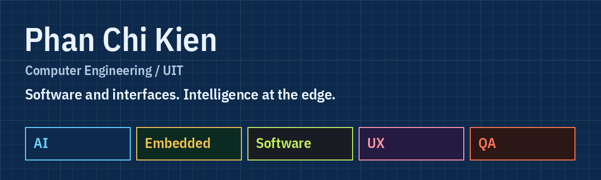

<picture>
  <source media="(max-width: 600px)" srcset="blueprint-mobile.png">
  <source media="(prefers-reduced-motion: reduce)" srcset="blueprint.png">
  
</picture>

[Portfolio](https://phanchikien-portfolio.vercel.app/) · [LinkedIn](https://www.linkedin.com/in/phanchikien/) · [Behance](https://www.behance.net/kienphan13)

Computer Engineering student at **University of Information Technology, VNU-HCM**. I build software and interfaces, with interests in AI, embedded systems, UX/UI and testing.

Currently an engineering intern at **Bosch Global Software Technologies Vietnam**. Previously a **UI/UX Product Design Trainee at LAZTAR**.

### Selected work

| Project | What I worked on |
| :--- | :--- |
| [UIT Portal](https://github.com/pckienuit/UIT_Portal_App) | Flutter client for student services, with an AI assistant served by an embedded Node.js runtime. |
| [AIoT Flight Face Lookup](https://github.com/pckienuit/AIoT_DoAn) | Offline face-recognition kiosk connecting a web client, FastAPI backend and MaixCAM RISC-V edge device. |
| [Zola Chat](https://github.com/pckienuit/Nhom14_ZolaChat) | Android chat app with a Node.js backend, Socket.IO messaging and WebRTC calls. |

### Toolkit

  &nbsp;
  &nbsp;
  &nbsp;
  &nbsp;
  &nbsp;
  &nbsp;
  &nbsp;
  

**Software:** Flutter, Dart, Python, Node.js, REST APIs, SQL  
**AI & embedded:** PyTorch, ONNX, FastAPI, C/C++, STM32, Linux  
**Design & delivery:** Figma, Git, Docker, API testing, test automation

[Get in touch](mailto:phanchikien@gmail.com) for software, AI, embedded systems or product design work.

I prefer clear constraints, observable behavior and a working slice before abstraction.

Explore all five portfolio lenses

The [portfolio](https://phanchikien-portfolio.vercel.app/) switches project order, writing, palette and resume for **AI**, **Embedded**, **Software**, **UX** and **QA**. Choose the lens relevant to your work.

